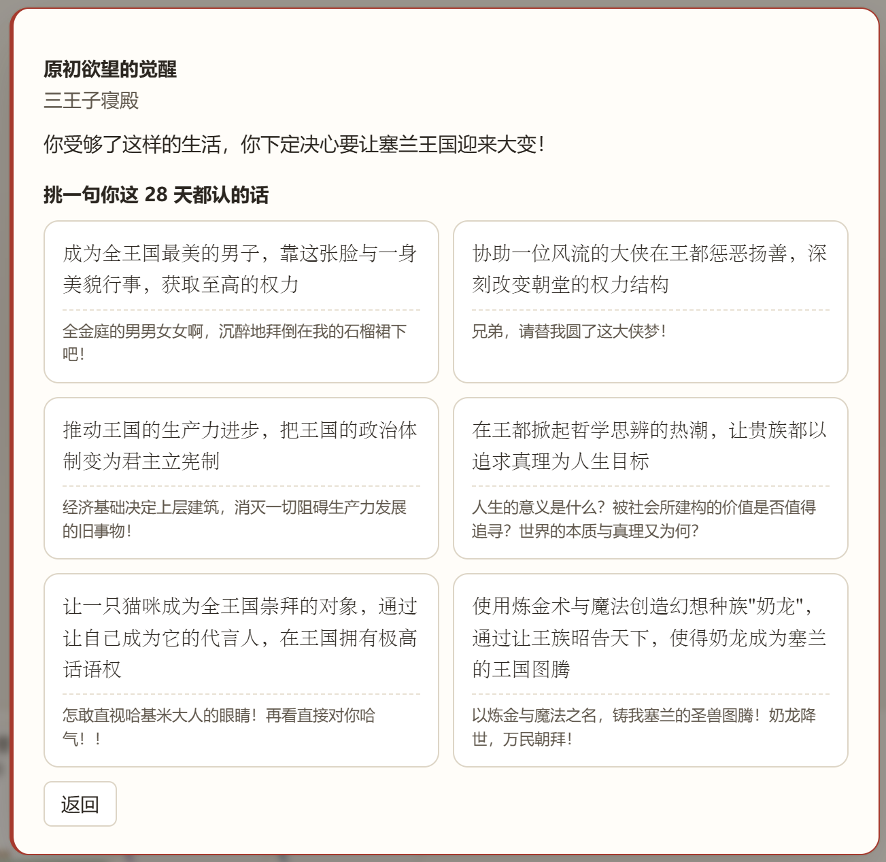
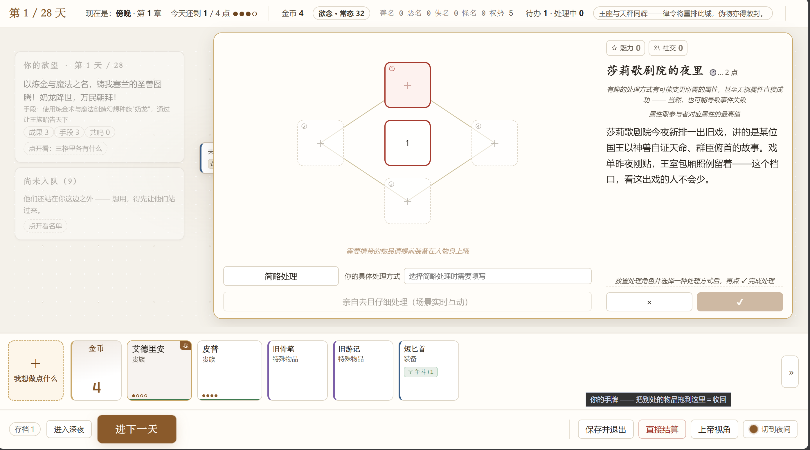
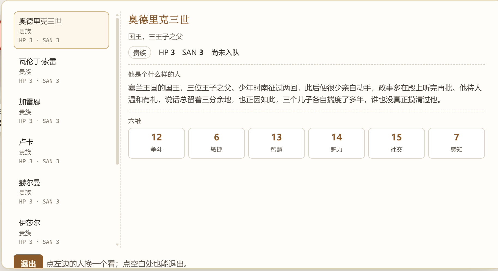
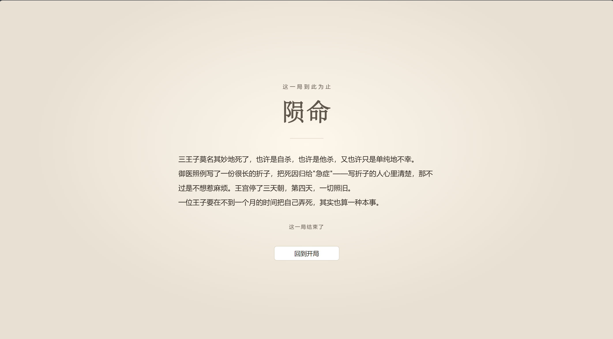

# 《王国三王子》

一款由大语言模型（LLM）驱动的**西幻王国叙事肉鸽游戏**。

你是王国里的一位王子。塞兰王国的每一天，市集、宫廷、酒馆、神殿都会冒出一桩桩事情——但不同于传统RPG游戏，它们不是写死的剧本，你可以和LLM**共创独属于你的故事**；也不同于简单的AI文游，我们做好了优秀的游戏系统来保证**剧情的连贯合理**，和LLM的稳定输出，也设计了美观的**卡牌交互UI**来降低打字的疲劳感！

游戏界面展示（请查询饺子醋😋）：

   
 


  
 

## 玩法简介

你是塞兰王国的三王子，在这个老套的西幻王国世界里过着日复一日的老套王子生活 -- 终于有一天，你再也无法忍受这一切，你决定要让这个世界迎来大变！
在这接下来的28天里，你将要把你的决心付诸实践，那么你需要：

**先找到你的动机。** 一段序幕之后，你从几个「欲望原型」里挑一个——用美貌征服权力、引导一场新兴阶级的革命、还是让奶龙成为成为王国图腾？！它会是整局故事的底色。
**每一天，你都会撞上几件真事。** 市集、宫廷、酒馆、神殿各自冒出麻烦或机会。你可以**派人去办**——把手下的工夫分派出去，人办完了才回来交差；也可以**亲自去谈**：进入实时对话，和当事人当面周旋。处理方式从不受按钮限制，想赊账、砍价、用一句漂亮话绕开本该付的金币，直接开口就是——**你怎么说，世界就会怎么回应**。

**行动力即为时间点。** 一天只够走四步：早上出发，拨一次钟到正午，再拨是下午、傍晚，最后是深夜。做每件事都要付出时间，而且钟一拨、全城跟着一起走——派出去的人得等时间流到那一步，才回来交差。四步走完，就只能翻到第二天。所以**多招募人手、多并行处理事件**，是运营的关键。（办有些事要花钱，每周你会领到一笔例钱。）

**一件事，派对人，就成了一半。** 把物品卡拖到人物卡身上，就是让谁带上什么；把人物卡拖到事件卡上，就是派谁去办。合适的人带上合适的家伙，事情才容易成。

**而刁钻的想法从不吃亏。** 一条有意思的思路，可能直接改写这桩事的解法，甚至不用你出手就成了——当然，也可能翻车。

**最后，一切都指向「欲念」。** 你真正想要的那样东西，在 28 天尽头是得偿所愿，还是差一步美满，全看你把这股欲望推到了哪儿、有没有留下**凭证**向世界证明你的欲望宣言。

## 下载

```bash
git clone https://github.com/AI-TRPG-Game/AI-Rougelike-Narrative-Game
```

或者：GitHub 仓库页面 → **Code → Download ZIP** → 解压到任意目录。

## 准备两样东西

1. **Node.js 22.18 或更新版本**：到 [nodejs.org](https://nodejs.org/) 下载安装（一路默认即可）。项目零依赖、无构建步骤，Node 直接运行 TypeScript 源码——**直接跑 `.ts` 需要 22.18+ 才默认开启**，所以版本别低于它（拿不准就装官网最新 LTS）。
2. **模型 API Key**：可以使用 DeepSeek 或 SoCLaaS。DeepSeek 密钥可到 [platform.deepseek.com](https://platform.deepseek.com/) 创建；SoCLaaS 使用自己的服务密钥。实际费用及试用额度以服务商和账号为准。

然后配置密钥：

```bash
# 在游戏目录下
复制 game/.env.example 为 game/.env
# 打开 game/.env，把 DEEPSEEK_API_KEY=sk-replace-me 换成你自己的 key
```

### 使用 SoCLaaS / GLM 5.3 Flash

SoCLaaS 是实验性学校网关，试用模型可能移除或替换；**正常游玩推荐官方 DeepSeek API**。

在 `game/.env` 中配置：

```dotenv
LLM_PROVIDER=soclaas
SOCLAAS_API_KEY=your-soclaas-api-key
SOCLAAS_MODEL=x-test-1
```

`x-test-1` 为 GLM 5.3 Flash，`x-test-2` 为学校的 DeepSeek V4.1 Flash；两者共用学校密钥，切换时只改 `SOCLAAS_MODEL`。修改配置后重启游戏。切回官方 DeepSeek 时设置 `LLM_PROVIDER=deepseek` 并填写 `DEEPSEEK_API_KEY`。

推理默认 `none`；更多配置见 [game/.env.example](game/.env.example)。请勿提交 `game/.env` 中的密钥。

## 启动

**双击根目录的「启动游戏.vbs」**——它会先自动清掉上一个游戏服务（避免残留实例出 bug），再启动本地服务（真模型模式），随后打开浏览器进入游戏。

> 也可以用命令行启动：
> 
> ```bash
> node game/src/ui/server.ts --live          # 真模型（与双击 vbs 等效）
> node game/src/ui/server.ts                 # 离线试玩：假 AI、零成本、不花钱，用来熟悉界面
> ```
> 
> 启动后浏览器访问 `http://127.0.0.1:5188`。

**关闭游戏**：双击根目录的「关闭游戏.vbs」即可精准停掉游戏服务（不影响电脑上其他 Node 程序）；也可以直接关掉任务栏里那个最小化的服务端窗口。

## 存档与目录

| 路径            | 内容                             |
| ------------- | ------------------------------ |
| `game/saves/` | 你的存档（本地数据库，4 个槽位），**不会被上传到仓库** |
| `game/runs/`  | 每局真模型的调用证据（留档排查用），不会被上传        |
| `game/.env`   | 你的 API Key，**永远不会**被提交进 git    |

# 
